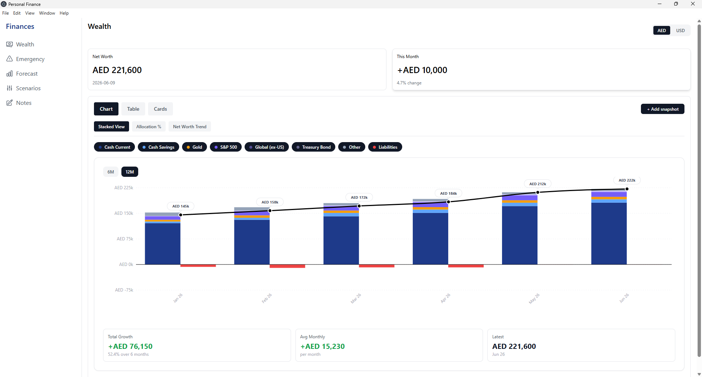
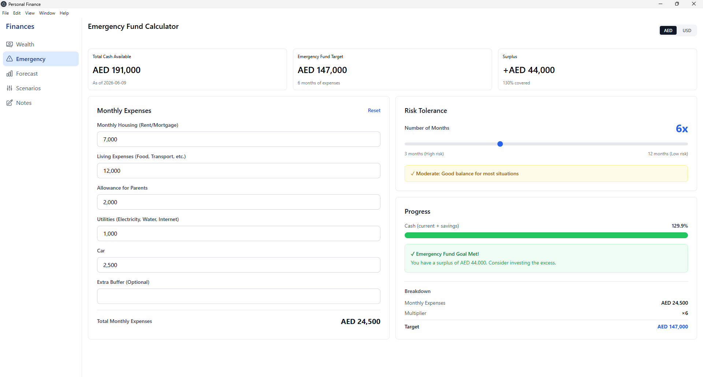
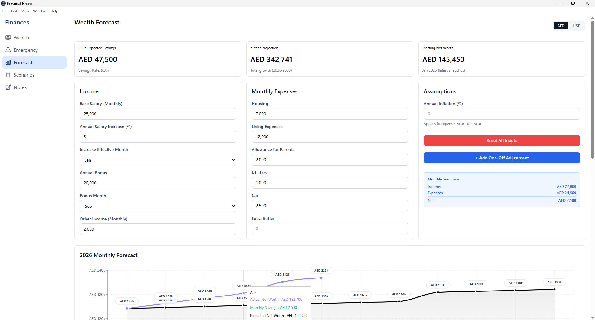
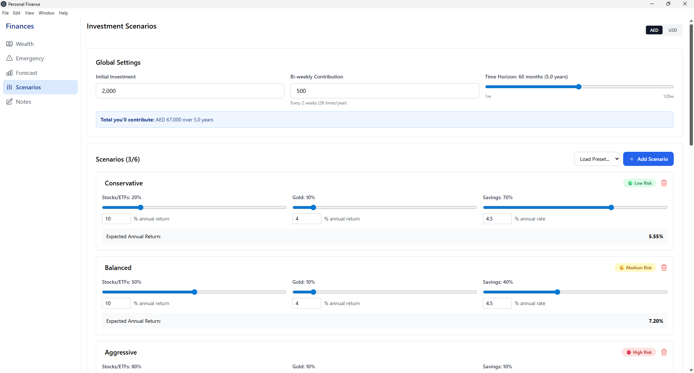

# Finances: Personal Finance Desktop App

A privacy-first desktop app for tracking net worth, planning ahead and testing financial scenarios. All data stays on your computer; nothing is sent to the cloud.



## Why I built it

I tracked my finances in spreadsheets for years and wanted something with the polish of a modern fintech app, without handing my financial data to a third-party service. So I designed and built my own, end to end: from Figma mockups to a packaged Windows installer.

## Features

**Wealth tracking**
- Record net worth snapshots across cash accounts, savings (with interest rate), gold, equity and bond ETFs, receivables and credit card debt
- Three views: interactive charts, a collapsible balance-sheet table, and a card timeline
- Charts for stacked asset composition, allocation %, and net worth trend, with 6/12-month ranges and per-category toggles
- Month-over-month growth, average monthly change, and notes attached to each snapshot

**Planning**
- **Emergency fund:** calculates a target from monthly expenses (housing,
  living, family support, utilities, car, buffer) and an adjustable 3–12 month
  risk tolerance, then compares it with available cash from the latest snapshot
  to show coverage %, surplus or shortfall, and a recommendation.
- **Forecast:** projects net worth month by month for the current year and
  annually over five years, from income assumptions (salary, annual raise and
  its effective month, bonus and its payout month, other income), monthly
  expenses and inflation. Tracks actual snapshots against the projection,
  breaks down income vs expenses per month, and supports one-off adjustments.
- **Scenarios:** compares up to six investment strategies side by side, each
  with its own allocation across stocks/ETFs, gold and savings and its own
  expected returns. Given an initial investment, bi-weekly contributions and a
  time horizon, it shows final value, total gain and ROI, growth over time vs
  total contributed, and breakeven insights (e.g. when one strategy overtakes
  another). Includes risk labels and presets.

**Everywhere**
- App-wide AED / USD currency toggle
- Free-form notes page

## Screenshots

| Emergency Fund | Forecast | Scenarios |
|---|---|---|
|  |  |  |

## Tech stack

- **Frontend:** React, Tailwind CSS, Recharts, Heroicons
- **Desktop:** Electron (packaged with electron-builder)
- **Backend:** Python (openpyxl) for calculations and storage

## Architecture

```
React UI → Electron (IPC via secure preload bridge) → Python engine → local Excel file
```

- The React interface never touches the file system directly; it calls a small, explicit API exposed through Electron's `contextBridge` (context isolation on, Node integration off).
- Electron runs the Python engine as a child process and exchanges JSON with it.
- Data is stored in the user's app data folder (`%APPDATA%\finance-app`), separate from the program, so reinstalling or updating never touches it.

## Installation (Windows)

1. Download the latest installer from [Releases](../../releases).
2. Install [Python](https://www.python.org/downloads/), then run:

```
pip install openpyxl
```

3. Run the installer. Windows may show a SmartScreen warning because the app isn't code-signed: click **More info → Run anyway**.

## Running from source

```
git clone https://github.com/yasmin-wehbe/finance-app.git
cd finance-app
npm install
pip install openpyxl
npm run electron-dev
```

To build the installer:

```
npm run electron-build
```

## Roadmap

- Credit card statement import (CSV / PDF) with automatic spending categorization
- Live gold and ETF price fetching
- Rewards (Marriott Bonvoy points) estimation
- Data export / backup and optional app password